**Assignment 2**\
**MSSV:** 24280080\
**Họ và tên:** Nguyễn Diệu Lê

# Báo cáo: Dự đoán giá xe ô tô (Regression)
**Dataset:** Automobile Price Dataset.\
**Biến mục tiêu:** `Price` (giá xe, giá trị liên tục → bài toán Regression).

## 1. Giới thiệu bài toán.
Ta cần xây dựng mô hình dự đoán giá ô tô dựa trên 16 đặc trưng ban đầu là:

- Thông tin kỹ thuật: `Engine volume`, `Cylinders`, `Mileage`, `Fuel type`, `Gear box type`, `Drive wheels`, `Doors`, `Wheel`.
- Thương hiệu: `Manufacturer`, `Model`.
- Chức năng: `Category`
- Đặc điểm khác: `Color`, `Leather interior`, `Airbags`, `Levy`.
- Năm sản xuất: `Prod. year`

Biến mục tiêu là dự đoán `Price`.

Đây là bài toán regression vì giá xe là giá trị liên tục.

## 2. Mô tả dataset.

### 2.1. Trước khi tiền xử lý
Tập dữ liệu `train.csv` có 19237 dòng, 18 cột. Mỗi dòng mang thông tin các đặc trưng của một chiếc xe và giá bán tương ứng. Trong đó, ý nghĩa của mỗi cột như sau:

0. **ID** - str: Mã định danh của mỗi chiếc xe
1. **Price** - int64: Giá bán của xe (target).
2. **Levy** - str: Thuế/phí nhập khẩu hoặc phí đăng ký xe.
3. **Manufacturer** - str:	Hãng sản xuất xe.
4. **Model** - str:	Dòng xe cụ thể của hãng.
5. **Prod. year** - int64: Năm sản xuất của xe.
6. **Category** - str: Loại xe.
7. **Leather interior** - str: Nội thất da hay không (= True nếu có, = False nếu không có).
8. **Fuel type** - str: Loại nhiên liệu sử dụng.
9. **Engine volume** - str:	Dung tích động cơ
10. **Mileage** - str: Số km đã đi của xe.
11. **Cylinders** - float64: Số xi-lanh của động cơ.
12. **Gear box type** - str: Loại hộp số.
13. **Drive wheels** - str: Hệ dẫn động.
14. **Doors** - str: Số cửa xe (ở dạng khoảng, không phải số liên tục).
15. **Wheel** - str: Vị trí vô lăng.
16. **Color** - str: Màu xe
17. **Airbags** - int64: Số lượng túi khí được trang bị trên xe.

### 2.2. Sau khi tiền xử lý

Có thêm 2 cờ đánh dấu và 2 biến numerical mới:

- `Levy`, `Engine volume`, `Mileage` chuyển sang dạng **numerical**. Trong đó:
    - Những giá trị '-' ở cột `Levy` gán bằng 0, thêm cờ `Levy missing` để đánh dấu.
    - `Engine volume` tách số ra khỏi chuỗi với 'Turbo', thêm cờ `Turbo` để đánh dấu.
    - Tách đơn vị 'km' ra khỏi cột `Mileage`.
- `Airbags` và `Cylinders` chuyển sang dạng **str**.
- `Leather interior` chuyển sang dạng **numerical** (= 1 nếu Yes, = 0 nếu No).
- Ngoài ra, thêm 2 biến mới:
    - `Age` = năm hiện tại − `Prod. year`; 
    - `Mileage per year` = `Mileage`/(`Prod. year` + 1);

Như vậy, từ 16 biến đầu vào ban đầu, ta đã tạo thêm 4 biến mới:
- `Age`: Tuổi của xe, có thể thay thế cho biến `Prod. year`.
- `Mileage per year`: Số km đi được trung bình trong 1 năm.
- `Turbo`: Cờ đánh dấu xe có động cơ Turbo hay không.
- `Levy missing`: Cờ đánh dấu giá trị thuế ban đầu có bị bỏ trống hay không.

## 3. Khám phá dữ liệu.

### 3.1. Numerical Features

Trước tiên, ta quan sát phân phối các biến số liên tục:
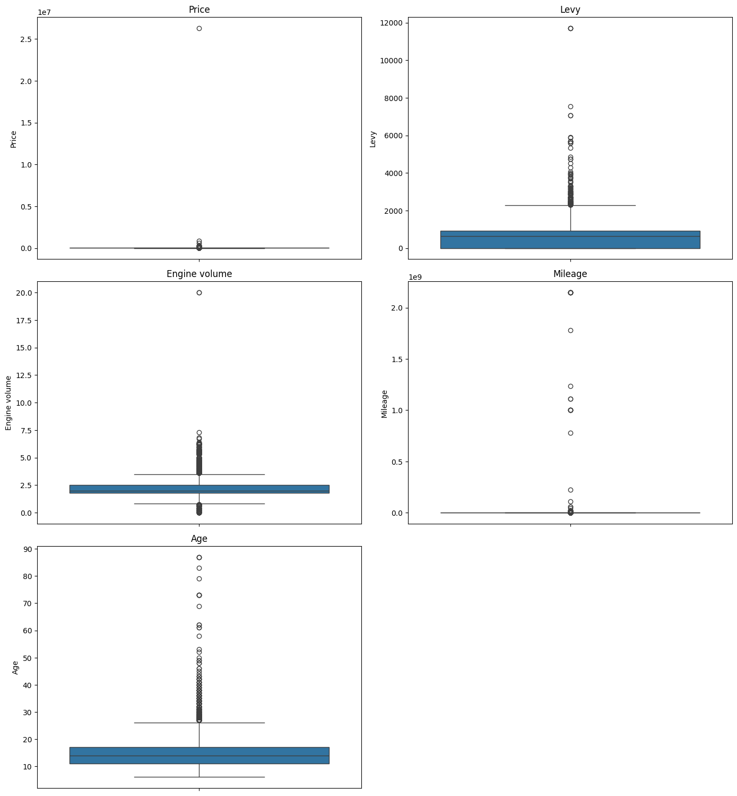

***Hình 1**. Boxplot thể hiện phân phối của giá xe (Price), thuế (Levy), dung tích động cơ (Engine volume), số km đi được (Mileage), tuổi của xe (Age).*

**Insight**: Hầu như tất cả các biến đều xuất hiện rất nhiều giá trị ngoại lai, cho thấy dữ liệu có độ lệch lớn hoặc chứa nhiều giá trị cực đoan.
- Price (Giá): Có giá trị ngoại lai cực kỳ cao so với phần còn lại, đó là những xe có giá trị vượt trội hoàn toàn so với phân khúc phổ thông. Ngoài ra, theo thống kê cho thấy có xe giá chỉ 1 USD (vô lý).
- Levy (Thuế): Có lượng ngoại lai dày đặc ở phía trên cho thấy một nhóm lớn các xe có mức thuế cao bất thường, có thể là do cấu tạo động cơ hoặc quy định thuế đặc thù đối với các dòng xe đó.
- Engine volume (Dung tích động cơ): Có các giá trị ngoại lai đáng chú ý, đặc biệt là một giá trị rất cao (lên đến 20). Ngoài ra theo thống kê, có những xe có dung tích là 0 (vô lý).
- Mileage (Số km đã đi): Có những ngoại lai rất vô lý (hơn 2 tỷ km), nên được loại bỏ trước khi đưa vào mô hình.
- Age (Tuổi của xe): Có một dải ngoại lai kéo dài t 30-90 năm tuổi, đây là những chiếc xe cổ nhưng có thể "nhiễu" đối với mô hình dự đoán.

**Hướng tiếp cận với mô hình:** Trước khi xây dựng mô hình, nên xử lý các giá trị ngoại lai này.
- Loại bỏ các ngoại lai do lỗi dữ liệu: Mileage > 1 triệu km và Engine volume > 10.
- Chỉ train trên tập dữ liệu có giá (Price) nằm dưới mức upper quantile = 0.995.

Sau khi loại bỏ các giá trị ngoại lai, ta quan sát phân phối các biến liên tục sau:
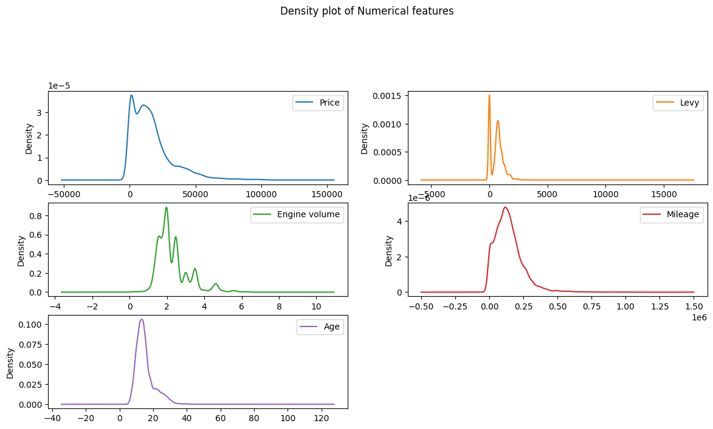

***Hình 2**. Phân phối của giá xe (Price), thuế (Levy), dung tích động cơ (Engine volume), số km đi được (Mileage), tuổi của xe (Age) sau khi loại bỏ outliers.*

**Insight:**
- Price (Giá): Biểu đồ cho thấy một đỉnh nhọn cực cao tại giá trị gần bằng 0. Điều này chỉ ra rằng phần lớn dữ liệu về giá tập trung ở mức rất thấp.
- Levy (Thuế): Phân bố lệch phải rõ rệt với một đỉnh chính gần 0 và một phần đuôi kéo dài sang phải. Có một nhóm nhỏ giá trị dương tập trung, cho thấy phần lớn xe có mức thuế thấp, nhưng có những xe có mức thuế rất cao.
- Engine volume (Dung tích động cơ): Phân bố có nhiều đỉnh nhỏ (multimodal), tập trung chủ yếu trong khoảng từ 1 đến 5.
- Mileage (Số km đã đi): Lệch phải mạnh, đa số xe tập trung ở mức số km thấp (từ 0 đến 250,000 km), nhưng lại có một "cái đuôi" dài kéo đến 1,000,000+ km.
- Age (Tuổi của xe): Phân bố lệch phải cho thấy phần lớn xe trong tập dữ liệu nằm trong độ tuổi từ khoảng 10 đến 20 năm, với đỉnh cao nhất tập trung ở mức khoảng 12-16 năm tuổi. Phân bố này phản ánh rõ ràng đặc tính của tập dữ liệu là tập trung vào các dòng xe đã qua sử dụng một thời gian đáng kể.

**Hướng tiếp cận với mô hình:** Biểu đồ phân phối của Price, Levy, Mileage lệch phải mạnh, việc sử dụng log transformation đối với model Linear/KNN là cần thiết để dữ liệu gần với phân phối chuẩn hơn.

Quan sát sâu hơn về mối quan hệ giữa các biến số liên tục với biến mục tiêu `Price`:
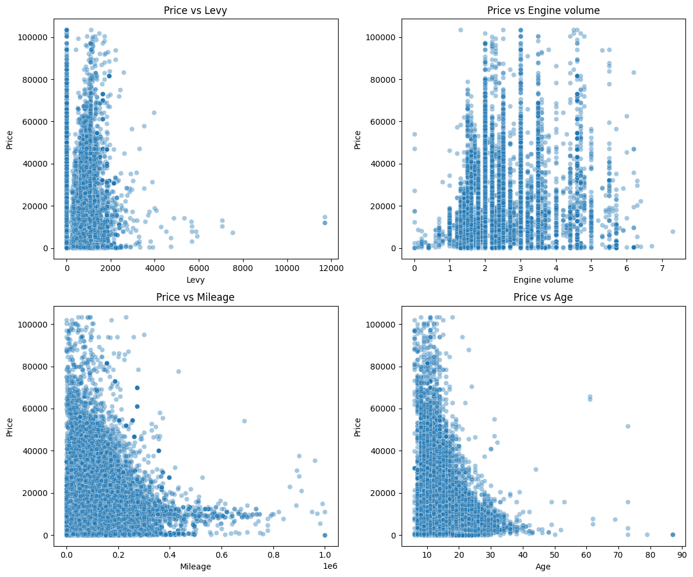

***Hình 3**. Mối quan hệ giữa các biến số thuế (Levy), dung tích động cơ (Engine volume), số km đi được (Mileage), tuổi của xe (Age) với giá xe (Price).*

**Insight:**
- Cả 4 biểu đồ đều cho thấy sự tồn tại của một số điểm dữ liệu có giá cực cao so với mặt bằng chung (đặc biệt là điểm ở vùng giá trên 800,000). Những giá trị này có thể gây nhiễu và làm sai lệch đường hồi quy của mô hình.
- Mối quan hệ phi tuyến tính:
  - Mileage (Số km đã đi) và Age (Tuổi đời): Có mối quan hệ nghịch biến rõ rệt với Price. Giá xe giảm mạnh khi tuổi đời và số km tăng lên, nhưng xu hướng này có vẻ không phải là đường thẳng hoàn hảo (có dạng cong). Đây là lý do ta tạo thêm biến `Mileage per year` = Mileage / (Age + 1) — cường độ sử dụng. Một xe 15 năm chạy 50.000 km khác hẳn xe 15 năm chạy 300.000 km — thông tin này không nằm trong Mileage hay Age riêng lẻ. Đây là tín hiệu mới có giá trị.
  - Levy: Có sự tập trung dữ liệu lớn ở vùng Levy thấp, phân tán mạnh ở vùng trung bình và thưa dần khi Levy cao.
- Engine volume (Dung tích động cơ): Mối quan hệ không quá rõ ràng. Có vẻ như các xe có dung tích động cơ ở mức trung bình (khoảng 2.0 - 4.0) có dải giá phân bổ rộng hơn, trong khi các giá trị cực thấp hoặc cực cao có mật độ dữ liệu ít hơn.

Với `Mileage per year`, ta cần quan sát thêm về phân phối và mối quan hệ của biến mới này đối với biến mục tiêu `Price`:
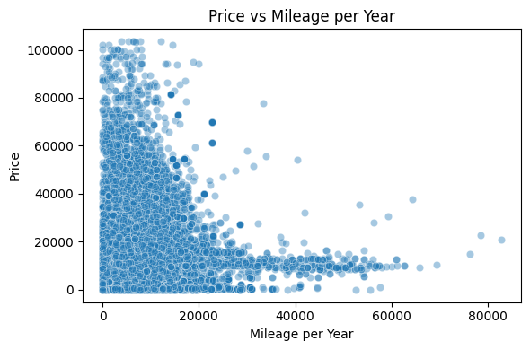

***Hình 4**. Mối quan hệ giữa số km đi được trung bình trong năm (Mileage per year) với giá xe (Price).*

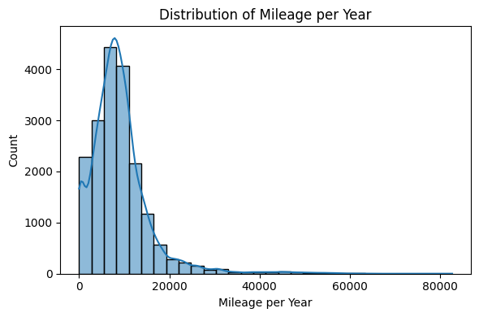

***Hình 5**. Phân phối của biến số km đi được trung bình trong năm (Mileage per year)*

**Insight:** 
- Biểu đồ phân tán giữa `Mileage per year` và `Price` (***Hình 4***) cho thấy giá xe khấu hao theo đường cong (phi tuyến); giảm cực mạnh khi xe mới đi ít, nhưng "bão hòa" (rẻ bèo) khi xe đi quá nhiều.
- Phân phối của `Mileage per year` (***Hình 5***) lệch phải mạnh, cho thấy dữ liệu tập trung cực cao ở nhóm "di chuyển ít" (dưới 20.000 dặm/năm). Những chiếc xe có mileage cao (>40.000) chỉ là các ngoại lệ (outliers) hiếm hoi.

**Hướng tiếp cận với mô hình:** Dùng log transformation trước khi đưa vào mô hình Linear/KNN hoặc dùng mô hình cây (trees) để nắm bắt đường cong này.

Cuối cùng, ta quan sát chỉ số tương quan của 5 biến số liên tục `Levy`, `Mileage`, `Mileage per year`, `Engine volume`, `Age` đối với `Price` để đánh giá sơ lược hiệu quả của các mô hình hồi quy đối với bài toán này:

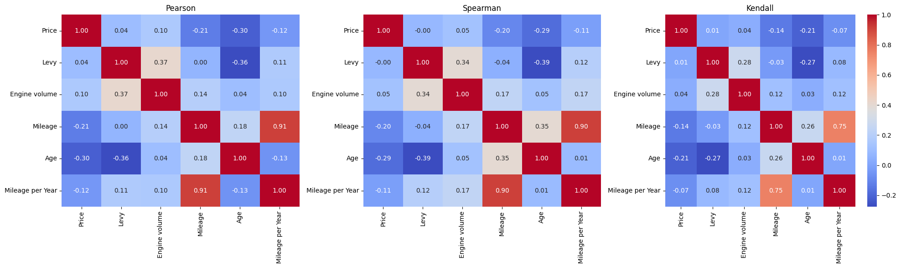 

***Hình 6**. Heatmap tương quan giữa 5 biến liên tục với giá xe (Price) đo bằng 3 phương pháp Pearson, Spearman, Kendall.*

**Insight:** Các hệ số tương quan tuyến tính nhìn chung khá thấp (đều nằm trong khoảng [-0.39, 0.37]). Do đó, việc chỉ dựa vào các mô hình hồi quy tuyến tính đơn giản có thể không mang lại kết quả dự báo tốt.

### 3.2. Categorical Features

Trước tiên, ta quan sát phân phối của các biến phân loại có ít nhãn (dưới 20 nhãn):
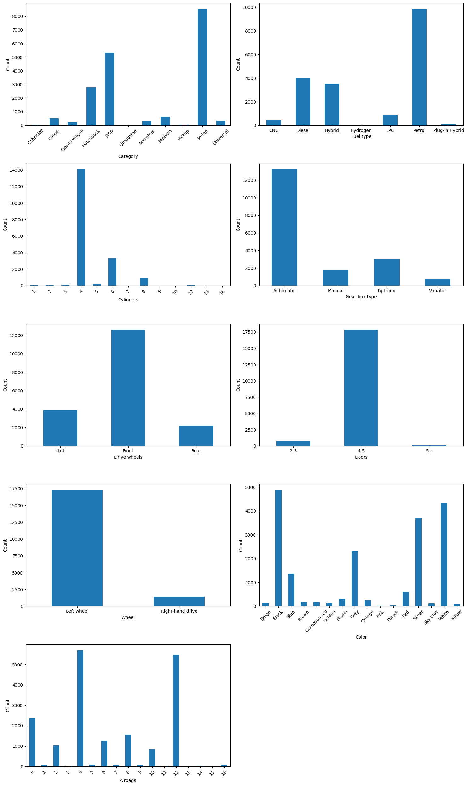

***Hình 7**. Biểu đồ cột thể hiện phân phối của các biến phân loại ít hơn 20 nhãn: loại xe (Category), loại nhiên liệu (Fuel type), Số xi lanh (Cylinders), loại hộp số (Gear box type), Hệ dẫn động (Drive wheels), số cửa (Doors), vị trí vô lăng (Wheel), màu (Color), số túi khí (Airbags).*

**Insight:**
- Category (Loại xe): Dữ liệu bị lệch rất nặng về dòng Sedan, trong khi các dòng như Limousine, Pickup hay Cabriolet gần như không đáng kể.
- Fuel type (Loại nhiên liệu): Đa số xe chạy Petrol (xăng), tiếp đến là Diesel và Hybrid. Xe chạy Hydrogen gần như không có dữ liệu.
- Cylinders (Số xi lanh): Xe có 4, 6 hoặc 8 xi lanh thống trị hoàn toàn, số còn lại phân bổ rải rác.
- Gear box type (Loại hộp số): Hộp số Automatic (tự động) chiếm đại đa số. Sự chênh lệch này cho thấy thị trường xe này ưu tiên sự tiện lợi.
- Drive wheels (Hệ dẫn động): Dẫn động Front (cầu trước) chiếm ưu thế, tiếp đến là 4x4 và Rear (cầu sau). Biến này ảnh hưởng trực tiếp đến khả năng vận hành và phân khúc giá (ví dụ: xe 4x4 thường đắt hơn do tính năng off-road)
- Doors (Số cửa): Hầu hết xe là dòng 4-5 cửa. Số cửa có thể không mang lại nhiều giá trị phân biệt vì hầu hết dữ liệu đều rơi vào một nhóm.
- Wheel (Vị trí vô lăng): Left wheel (Vô lăng trái) chiếm đa số tuyệt đối. Đây là biến mang tính chất địa lý, xe "Right-hand drive" ở các quốc gia lái xe bên phải thường là xe nhập khẩu đặc biệt, giá có thể rất cao hoặc rất thấp tùy mục đích (đồ cổ/siêu xe).
- Color (Màu sắc): Các màu trung tính như Black, White, Silver chiếm tỷ trọng lớn nhất. Biến này thường không ảnh hưởng quá lớn đến giá trừ một số màu đặc biệt (như màu độc lạ của siêu xe).
- Airbags (Số túi khí): Phân bổ tập trung cao ở mức 4 và 12 túi khí.

**Hướng tiếp cận với mô hình:**
- Để giúp mô hình không bị "nhiễu" bởi các nhóm dữ liệu hiếm, nên gom nhóm các danh mục có tần suất thấp (Category là Limousine, Pickup hay Cabriolet, Fuel type là Hydrogen)
- Nên dùng Target Encoding để biến màu sắc thành giá trị trung bình về giá.

Tiếp theo, ta quan sát phân phối của top 15 hãng sản xuất và dòng xe (các biến có nhiều hơn 20 nhãn phân loại):
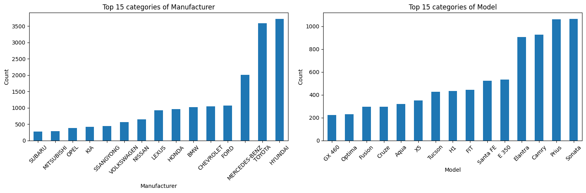

***Hình 8**. Top 15 hãng sản xuất (Manufacturer) và dòng xe (Model) có nhiều xe nhất.*

**Insight:**
- Manufacturer (Hãng sản xuất): Có sự phân hóa cực kỳ rõ rệt: Huyndai và Toyota chiếm ưu thế tuyệt dối. Đây là biến quan trọng mang thông tin về thương hiệu, ảnh hưởng trực tiếp đến giá trị bán lại.
- Model (Dòng xe): Các dòng xe phổ thông như Prius, Sonata, Camry, Elantra xuất hiện với tần suất rất cao, cho thấy tập dữ liệ tập trung vào dòng xe phổ thông, không phải xe sưu tầm hay siêu xe.

**Hướng tiếp cận với mô hình:** Dùng Target Encoding cho các biến phân loại nhiều nhãn này.

Ta tiếp tục quan sát sâu hơn vào phân phối về giá theo từng nhãn của các biến phân loại:

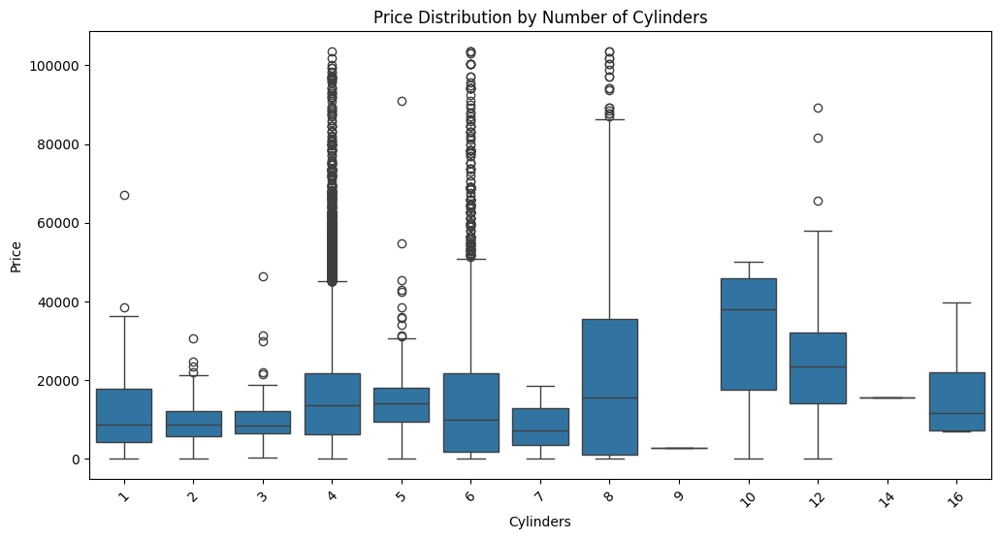

***Hình 9**. Phân phối về giá (Price) theo từng nhóm số lượng xi lanh (Cylinders).*

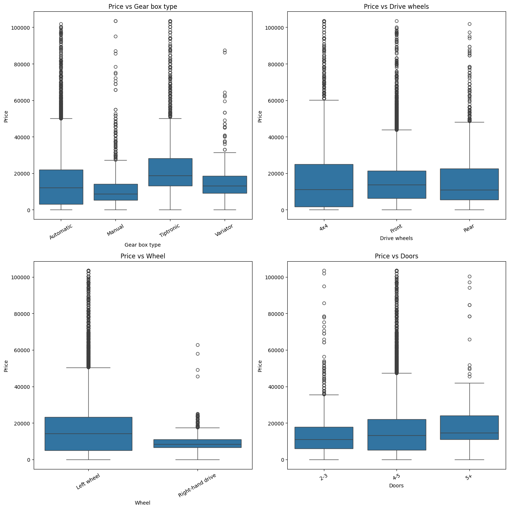

***Hình 10**. Phân phối về giá (Price) theo từng nhóm phân loại của loại hộp số (Gear box type), hệ dẫn động (Drive wheels), vị trí vô lăng (Wheel), số cửa (Doors).*

**Insight:**
- Nhiễu cực đoan: Các biến số như Cylinders, Gear box, hay Drive wheels không chỉ đơn thuần là kỹ thuật, mà là chỉ dấu của phân khúc. Những xe có 8 xi-lanh hoặc dẫn động 4x4, Tiptronic thường nằm ở "đuôi dài" của phân phối (giá cực cao).
- Đa số dữ liệu tập trung ở nhóm "phổ thông" (4 xi lanh, Automatic, Front-wheel), trong khi những "điểm dữ liệu ngoại lai" (outliers) có giá trị cực cao là nhân tố gây nhiễu lớn nhất cho mô hình hồi quy truyền thống nếu không được xử lý riêng biệt.

Quan trọng hơn, giá của một chiếc xe phụ thuộc rất lớn vào thương hiệu:

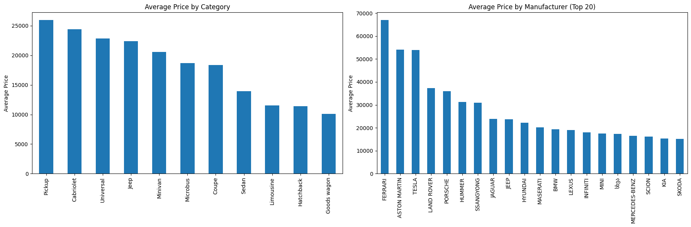

***Hình 11**. Top những loại xe (Category) và hãng sản xuất (Manufacturer) có giá xe trung bình cao nhất.*

**Insight:**
- Nghịch lý giữa "Độ phổ biến" và "Giá trị": 
    - Loại xe: Sedan là loại xe phổ biến nhất với số lượng áp đảo, nhưng lại nằm ở nửa dưới về giá trung bình. Ngược lại, Pickup có số lượng rất thấp nhưng lại là loại xe có giá trung bình cao nhất. Như vậy, thị trường tập trung vào các mẫu xe Sedan cho nhu cầu đại chúng, trong khi các dòng xe như Pickup thuộc phân khúc đặc thù, giá trị cao và ít cạnh tranh về số lượng hơn.
    - Nhà sản xuất: Hyundai và Toyota dẫn đầu về tần suất xuất hiện trên thị trường, nhưng không lọt vào top 3 nhà sản xuất có giá trung bình cao nhất. Chiến lược kinh doanh của các hãng dẫn đầu thị trường là tối đa hóa doanh số thông qua các sản phẩm phổ thông, thay vì tập trung vào xe sang (như Ferrari, Aston Martin hay Tesla).
- Sự phân hóa thị trường của các dòng xe "ngách"
    - Dòng Jeep có sự cân bằng thú vị: nó nằm trong top 4 về giá trung bình và cũng nằm trong top 4 về tần suất xuất hiện (phổ biến) trong các loại xe. Jeep là một trường hợp đặc biệt—dù là dòng xe chuyên dụng nhưng lại đạt được mức độ phổ biến cao, cho thấy nhu cầu lớn và khả năng duy trì giá trị thương hiệu tốt của dòng xe này.
    - Tiềm năng của nhóm xe phổ thông: Nhóm các nhà sản xuất như Mercedes-Benz, Ford, Chevrolet có lượng xe lưu thông lớn đồng thời vẫn giữ được mức giá trung bình ổn định. Đây là nhóm các nhà sản xuất đạt được sự cân bằng giữa thị phần và biên lợi nhuận.

### 3.3. Binary Features

Quan sát phân phối về giá theo các biến phân loại nhị phân:

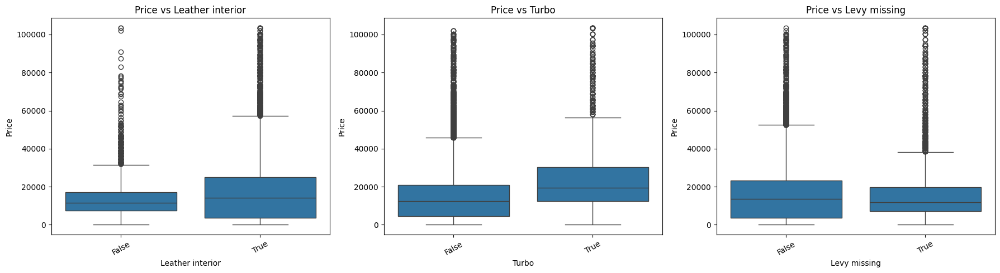

***Hình 12**. Phân phối về giá (Price) theo từng nhóm phân loại của các biến nhị phân.*

**Insight:**
- Các xe có nội thất da và động cơ Turbo đều có mức giá trung vị và phân phối giá cao hơn hẳn so với xe không có các đặc tính này. Đây là đặc trưng mạnh giúp phân loại giá.
- Ở biểu đồ Levy missing, những xe có dữ liệu bị thiếu có giá thấp hơn so với những xe có đầy đủ dữ liệu. Điều này cho thấy việc "mất dữ liệu" không phải là ngẫu nhiên, mà nó mang thông tin (có thể xe cũ, xe giá trị thấp nên không có thông tin thuế phí).
- Outliers: Cả 3 biểu đồ đều cho thấy rất nhiều điểm nằm ngoài râu hộp (outliers) ở phía trên (>60,000). Đây là các xe siêu sang hoặc xe đặc biệt, làm nhiễu mô hình dự báo giá phổ thông.

### 3.4. Độ cân bằng của dữ liệu

Ta đã đề cập đến việc phân phối của Price lệch phải mạnh lên cần dùng log transformation cho các mô hình như Linear/KNN. Tuy nhiên, nên quan sát phân phối của Price trước và sau khi dùng hàm log để kiểm tra bước xử lý này là cần thiết hay không.

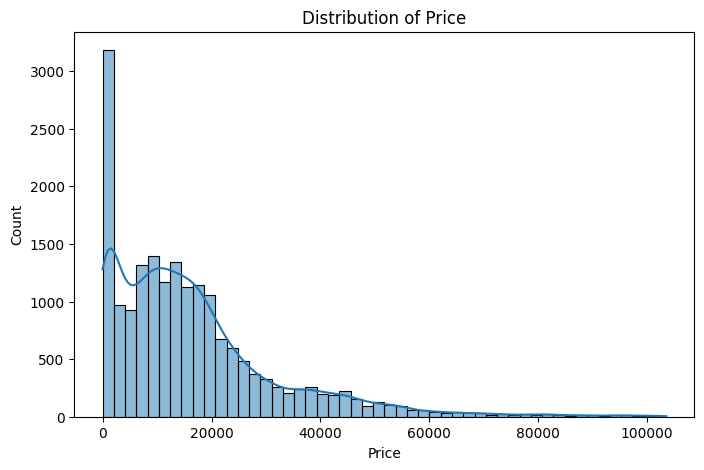

***Hình 13**. Phân phối của giá (Price) gốc (trước khi dùng hàm log).*

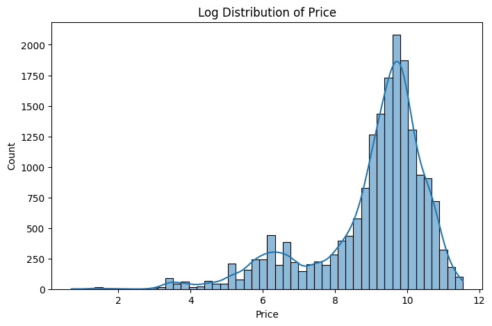

***Hình 14**. Phân phối của giá (Price) sau khi dùng hàm log.*

**Insight:**
- Về phân phối: Dữ liệu gốc bị lệch phải cực đoan do quá nhiều xe giá rẻ áp đảo. Việc áp dụng log-transform là bước "sống còn" để đưa dữ liệu về dạng gần chuẩn, giúp mô hình bớt bị nhiễu bởi các xe siêu sang và nhận diện rõ hơn các phân khúc giá.
- Về chiến lược: Biểu đồ sau log lộ rõ cấu trúc đa đỉnh (multimodal), chứng tỏ thị trường phân tách thành các nhóm xe rõ rệt thay vì một dải liên tục, nên dùng mô hình dựa trên cây để mô hình tự học các "ngưỡng giá" phân tầng này thay vì cố gắng tinh chỉnh thủ công các biến kỹ thuật.

## 4. Tiền xử lý dữ liệu

### 4.1. Làm sạch và biến đổi cột

Dữ liệu thô có nhiều cột ở dạng chuỗi lẫn ký tự đơn vị, cần đưa về dạng số hoặc dạng phân loại sạch trước khi mô hình hóa. Các biến đổi được thực hiện trong hàm `_transform_columns`:

- **`Levy`**: trong dữ liệu gốc, giá trị thiếu được ghi bằng dấu `"-"`. Cột này được ép về số (`"-"` trở thành `NaN`), sau đó:
  - Tạo thêm cờ `Levy missing` (1 nếu thiếu, 0 nếu có giá trị) để giữ lại thông tin "dòng này vốn không có Levy".
  - Điền giá trị thiếu bằng `0`.

- **`Engine volume`**: cột này chứa cả dung tích động cơ lẫn nhãn "Turbo" (ví dụ `2.0 Turbo`). Ta tách thành hai phần:
  - Cờ nhị phân `Turbo` (1 nếu chuỗi có chứa "Turbo").
  - `Engine volume` được làm sạch bằng cách bỏ chữ "Turbo" và ép về số.

- **`Mileage`**: bỏ đơn vị `" km"` rồi ép về số.

- **`Leather interior`**: ánh xạ `Yes` → 1, `No` → 0.

- **`Doors`**: gộp lại các nhãn cho dễ hiểu và giảm phân mảnh: `02-Mar` → `2-3`, `04-May` → `4-5`, `>5` → `5+`.

- **`Cylinders`, `Airbags`**: tuy là số nhưng số lượng giá trị rời rạc ít và mang tính nhóm, nên được chuyển về dạng chuỗi để xử lý như biến phân loại trong One-Hot Encoding.

#### Tạo đặc trưng mới (feature engineering)

Ngoài việc làm sạch, ta tạo thêm hai đặc trưng mang thông tin trực tiếp hơn so với năm sản xuất gốc:

- **`Age`** (tuổi xe) `= REFERENCE_YEAR - Prod. year`, với `REFERENCE_YEAR` là năm hiện tại. Tuổi xe phản ánh mức độ mất giá theo thời gian rõ hơn so với con số `Prod. year` thô.
- **`Mileage per year`** `= Mileage / (Age + 1)`. Đặc trưng này mô tả cường độ sử dụng xe (số km đi mỗi năm). Mẫu số cộng thêm 1 để tránh chia cho 0 với những xe sản xuất ngay trong năm hiện tại.

Sau bước này, cột `Prod. year` không còn được dùng trực tiếp vì thông tin của nó đã được `Age` thay thế.

### 4.2. Xử lý dòng trùng lặp, giá trị mục tiêu lỗi và outlier

Việc lọc dữ liệu được thực hiện trong hàm `clean_data` với tham số `drop_rows`:

- `drop_rows=True`: áp dụng cho **tập train** (loại bỏ dòng).
- `drop_rows=False`: áp dụng cho **tập test không nhãn** (chỉ biến đổi cột, giữ nguyên toàn bộ số dòng để xuất dự đoán đầy đủ).

Đối với tập train, các bước lọc gồm:

1. **Loại dòng trùng lặp** bằng `drop_duplicates()`.
2. **Giữ lại dòng có giá trị mục tiêu hợp lệ**: ép `Price` về số và chỉ giữ `Price > 0`.
3. **Lọc outlier** theo ngưỡng đã quan sát trong EDA:

   | Điều kiện | Ngưỡng | Lý do |
   |---|---|---|
   | `Mileage` | ≤ 1,000,000 | Loại các giá trị số km bất hợp lý do nhập liệu |
   | `Engine volume` | ≤ 10 | Loại dung tích động cơ phi thực tế |
   | `Price` | trong khoảng phân vị [0.0 ; 0.995] | Cắt 0.5% giá trị cao nhất để giảm ảnh hưởng của vài xe giá cực cao |

Việc cắt 0.5% giá cao nhất giúp các chỉ số như RMSE và R² ổn định hơn, vì một vài điểm giá cực cao nếu rơi vào tập test có thể làm tổng sai số tăng vọt.

> **Lưu ý:** việc loại outlier **chỉ áp dụng cho tập train**. Tập test (cũng như tập test không nhãn dùng để xuất dự đoán) không bị loại dòng, nhằm mô phỏng đúng tình huống thực tế là mô hình phải dự đoán trên mọi dữ liệu đầu vào, kể cả dữ liệu bất thường.

### 4.3. Tách đặc trưng và phân nhóm

Hàm `prepare_features` tách dữ liệu thành ma trận đặc trưng `X` và vector mục tiêu `y` (`Price`), đồng thời loại bỏ các cột không dùng để mô hình hóa: `ID` (mã định danh), `Prod. year` (đã thay bằng `Age`) và `Price` (biến mục tiêu).

Các đặc trưng còn lại được chia thành các nhóm để xử lý theo cách phù hợp với bản chất của chúng:

| Nhóm | Các đặc trưng | Cách xử lý |
|---|---|---|
| Số – lệch phải mạnh | `Levy`, `Mileage`, `Mileage per year` | Điền thiếu bằng trung vị, có thể log hóa (tùy họ mô hình) |
| Số – không lệch | `Engine volume`, `Age` | Điền thiếu bằng trung vị |
| Nhị phân | `Leather interior`, `Turbo`, `Levy missing` | Điền thiếu bằng giá trị xuất hiện nhiều nhất, giữ nguyên 0/1 |
| Phân loại nhiều giá trị | `Manufacturer`, `Model`, `Color` | Target Encoding |
| Phân loại ít giá trị | `Category`, `Fuel type`, `Cylinders`, `Gear box type`, `Drive wheels`, `Wheel`, `Doors`, `Airbags` | One-Hot Encoding |

Lý do tách riêng nhóm "phân loại nhiều giá trị": các cột như `Manufacturer`, `Model`, `Color` có rất nhiều giá trị khác nhau. Nếu One-Hot Encoding sẽ sinh ra hàng nghìn cột, làm dữ liệu thưa và khó học. Vì vậy ta dùng Target Encoding cho nhóm này.

### 4.4. Xử lý giá trị thiếu

Việc điền giá trị thiếu được đặt trong `Pipeline` và xử lý theo từng nhóm bằng `SimpleImputer`:

- **Đặc trưng số**: điền bằng **trung vị** (`median`) — bền vững với phân phối lệch và outlier hơn so với trung bình.
- **Đặc trưng nhị phân**: điền bằng **giá trị xuất hiện nhiều nhất** (`most_frequent`).
- **Đặc trưng phân loại** (cả One-Hot và Target Encoding): điền bằng một nhãn hằng số `"missing"`, tức là coi "thiếu" như một hạng mục riêng.

### 4.5. Mã hóa biến phân loại

- **One-Hot Encoding** (cho nhóm phân loại ít giá trị): dùng `OneHotEncoder` với `handle_unknown="ignore"` (bỏ qua nhãn lạ xuất hiện ở tập test) và `min_frequency=0.01`. Tham số `min_frequency` gộp các nhãn quá hiếm (xuất hiện dưới 1%) vào một nhóm chung, giúp giảm nhiễu và số chiều.

- **Target Encoding** (cho nhóm phân loại nhiều giá trị): mỗi giá trị hạng mục được thay bằng một con số liên quan đến giá trị mục tiêu trung bình của nhóm đó. Để tránh rò rỉ thông tin từ chính biến mục tiêu, ta dùng `TargetEncoder` với cơ chế kiểm định chéo nội bộ (`KFold` 5 phần, có xáo trộn, cố định `random_state`). Cơ chế này đảm bảo giá trị mã hóa của mỗi dòng được tính từ các dòng khác chứ không từ chính nó.

### 4.6. Tiền xử lý riêng theo từng họ mô hình

Thay vì dùng chung một bộ tiền xử lý, ta thiết kế hai phiên bản tùy theo bản chất mô hình (hàm `build_preprocessor`).

#### Họ mô hình cần khoảng cách/tuyến tính (Linear Regression, KNN)

Các mô hình này nhạy cảm với thang đo và phân phối của đặc trưng, nên cần:

1. **Log hóa các đặc trưng lệch phải** (`Levy`, `Mileage`, `Mileage per year`) bằng `log1p` để đưa phân phối về dạng cân đối hơn.
2. **Chuẩn hóa toàn bộ ma trận** sau khi mã hóa bằng `StandardScaler` (đưa các đặc trưng về cùng thang đo). Bước này đặc biệt quan trọng với KNN vì thuật toán dựa trên khoảng cách.

#### Họ mô hình cây (Decision Tree, Random Forest)

Các mô hình cây chia dữ liệu theo ngưỡng nên **không bị ảnh hưởng bởi thang đo cũng như phân phối lệch**. Vì vậy với họ này ta:

- **Không scale** và **không log hóa** đặc trưng (các phép biến đổi đơn điệu không làm thay đổi cách cây chia nhánh, nên vô ích).
- Chỉ giữ lại bước điền giá trị thiếu và mã hóa biến phân loại.

Cách tách riêng này giúp mỗi họ mô hình nhận được dạng dữ liệu phù hợp nhất với cơ chế hoạt động của nó.

### 4.7. Biến đổi biến mục tiêu (target transformation)

Giá xe (`Price`) có phân phối lệch phải. Theo kết luận từ EDA:

- **Với họ tuyến tính/khoảng cách** (Linear Regression, KNN): mô hình được huấn luyện trên `log(Price)` thông qua `TransformedTargetRegressor` (dùng `log1p` khi học và `expm1` khi dự đoán ngược). Việc này giúp giảm ảnh hưởng của phần đuôi giá cao và thường cải thiện kết quả của các mô hình tuyến tính.
- **Với họ cây** (Decision Tree, Random Forest): huấn luyện **trực tiếp trên `Price`**, vì cây không bị ảnh hưởng bởi phân phối lệch của biến mục tiêu.

Trong cả hai trường hợp, dự đoán cuối cùng đều được quy về đơn vị USD gốc, nên các chỉ số MAE/RMSE đều có thể diễn giải trực tiếp theo USD.

### 4.8. Chia train/test và phòng tránh rò rỉ dữ liệu

- Dữ liệu được chia theo tỉ lệ **80% train – 20% test** bằng `train_test_split` với `random_state=42` để kết quả có thể lặp lại.
- Toàn bộ các bước điền thiếu, mã hóa và chuẩn hóa đều nằm **bên trong `Pipeline`**, nên chúng chỉ học tham số (trung vị, danh sách nhãn, trung bình theo nhóm, mean/std để scale...) từ **tập train**. Khi áp dụng lên tập test, pipeline chỉ `transform` chứ không `fit`, đáp ứng đúng yêu cầu "không để dữ liệu test tham gia vào quá trình fit scaler/encoder".
- `TargetEncoder` dùng kiểm định chéo nội bộ để giá trị mã hóa không bị rò rỉ từ biến mục tiêu của chính dòng đang xét.
- Outlier chỉ được loại trên tập train; tập test không bị can thiệp.

## 5. Mô hình sử dụng

Ta huấn luyện **5 mô hình** thuộc ba thuật toán khác nhau, trải từ mô hình tuyến tính đơn giản đến mô hình tổ hợp phức tạp:

| Tên trong code | Thuật toán | Tham số chính | Họ tiền xử lý |
|---|---|---|---|
| Linear Regression | `LinearRegression` | mặc định | scaled (chuẩn hóa + log) |
| KNN | `KNeighborsRegressor` | `n_neighbors=10` | scaled (chuẩn hóa + log) |
| Decision Tree | `DecisionTreeRegressor` | `max_depth=7` | tree (không scale) |
| Decision Tree No Limit | `DecisionTreeRegressor` | không giới hạn độ sâu | tree (không scale) |
| Random Forest | `RandomForestRegressor` | `n_estimators=100`, `max_depth=15` | tree (không scale) |

Tất cả mô hình đều được huấn luyện trên **cùng một tập train** và đánh giá trên **cùng một tập test** (chia 80/20). Những mô hình có yếu tố ngẫu nhiên đều được cố định `random_state=42` để kết quả có thể lặp lại.

Như đã trình bày ở phần tiền xử lý, các mô hình được chia thành hai họ với cách chuẩn bị dữ liệu khác nhau:

- **Họ tuyến tính/khoảng cách** (Linear Regression, KNN): dữ liệu được log hóa các đặc trưng lệch và chuẩn hóa bằng `StandardScaler`; biến mục tiêu được huấn luyện trên `log(Price)`.
- **Họ cây** (Decision Tree, Random Forest): không scale, không log; huấn luyện trực tiếp trên `Price`.

### 5.1. Linear Regression

`LinearRegression` giả định giá xe có quan hệ tuyến tính với các đặc trưng đầu vào:

```text
Price ≈ w1 * Mileage + w2 * Age + w3 * Engine volume + ... + b
```

Mô hình tìm bộ trọng số sao cho sai lệch giữa giá dự đoán và giá thực tế là nhỏ nhất. Trọng số dương nghĩa là đặc trưng tăng thì giá có xu hướng tăng, và ngược lại.

Vì là mô hình dựa trên quan hệ tuyến tính và nhạy với thang đo, Linear Regression được đưa vào họ "scaled": các đặc trưng lệch (`Levy`, `Mileage`, `Mileage per year`) được log hóa, toàn bộ ma trận được chuẩn hóa, và mô hình học trên `log(Price)`.

**Ưu điểm:** đơn giản, chạy nhanh, dễ giải thích, phù hợp làm mô hình nền tảng để so sánh.

**Hạn chế:** khó mô tả các quan hệ phi tuyến phức tạp giữa các đặc trưng và giá xe; dễ bị ảnh hưởng bởi giá trị ngoại lệ.

### 5.2. K-Nearest Neighbors (KNN)

`KNeighborsRegressor` với `n_neighbors=10` dự đoán giá của một xe bằng cách lấy trung bình giá của 10 xe "gần nhất" trong không gian đặc trưng.

Vì KNN dựa hoàn toàn trên **khoảng cách** giữa các điểm dữ liệu, việc chuẩn hóa là bắt buộc: nếu không, các đặc trưng có thang đo lớn (như `Mileage`) sẽ lấn át hoàn toàn các đặc trưng thang đo nhỏ khi tính khoảng cách. Do đó KNN cũng thuộc họ "scaled" (log + `StandardScaler`, học trên `log(Price)`).

**Ưu điểm:** không giả định dạng quan hệ cụ thể, có thể nắm bắt được các vùng giá phi tuyến.

**Hạn chế:** nhạy với thang đo và với số chiều lớn; chậm khi dữ liệu nhiều; kết quả phụ thuộc vào việc chọn số láng giềng `k`.

### 5.3. Decision Tree (max_depth = 7)

`DecisionTreeRegressor` chia dữ liệu thành nhiều nhánh dựa trên các điều kiện ngưỡng, ví dụ:

```text
Nếu Mileage <= 100000:
    Nếu Age <= 5:
        dự đoán giá cao
    Ngược lại:
        dự đoán giá trung bình
Ngược lại:
    dự đoán giá thấp hơn
```

Mỗi lá của cây chứa giá trị dự đoán, thường là trung bình giá của các xe rơi vào lá đó. Tham số `max_depth=7` giới hạn độ sâu của cây để kiểm soát độ phức tạp và hạn chế overfitting.

Vì cây chia dữ liệu theo ngưỡng nên **không bị ảnh hưởng bởi thang đo hay phân phối lệch**, do đó thuộc họ "tree": không scale, không log đặc trưng, và huấn luyện trực tiếp trên `Price`.

**Ưu điểm:** mô hình hóa được quan hệ phi tuyến; trực quan, dễ hiểu; không cần chuẩn hóa.

**Hạn chế:** dễ overfitting nếu cây quá sâu; kết quả có thể thay đổi mạnh khi dữ liệu thay đổi nhỏ.

### 5.4. Decision Tree No Limit (không giới hạn độ sâu)

Đây là `DecisionTreeRegressor` **không đặt `max_depth`**, để cây phát triển tự do cho đến khi phân tách hết dữ liệu.

Mô hình này được đưa vào **chủ yếu để minh họa hiện tượng overfitting**: khi không bị giới hạn, cây có xu hướng gần như ghi nhớ toàn bộ tập train (kết quả train rất cao) nhưng tổng quát hóa kém trên tập test. So sánh với Decision Tree `max_depth=7` giúp thấy rõ vai trò của việc kiểm soát độ phức tạp mô hình.

Mô hình này cũng thuộc họ "tree" và huấn luyện trực tiếp trên `Price`.

### 5.5. Random Forest

`RandomForestRegressor` là mô hình tổ hợp, kết hợp nhiều cây quyết định. Cấu hình sử dụng: `n_estimators=100` (100 cây), `max_depth=15`, và `n_jobs=-1` để tận dụng nhiều luồng CPU khi huấn luyện.

Cơ chế hoạt động:

- Mỗi cây được huấn luyện trên một mẫu dữ liệu ngẫu nhiên (bootstrap).
- Khi chia nhánh, mỗi cây chỉ xét một nhóm đặc trưng ngẫu nhiên.
- Dự đoán cuối cùng là trung bình kết quả của tất cả các cây.

Việc lấy trung bình nhiều cây khác nhau giúp giảm phương sai và hạn chế overfitting so với một cây đơn lẻ, đồng thời vẫn giữ được khả năng học quan hệ phi tuyến. Random Forest cũng cung cấp được mức độ quan trọng của từng đặc trưng (feature importance), hữu ích cho việc phân tích.

Random Forest thuộc họ "tree": không scale, không log, huấn luyện trực tiếp trên `Price`. Trong pipeline, đây cũng là mô hình được ưu tiên dùng để phân tích feature importance và SHAP.

**Ưu điểm:** thường cho kết quả tốt hơn một cây đơn lẻ; giảm overfitting; đánh giá được mức quan trọng của đặc trưng.

**Hạn chế:** chạy chậm hơn Linear Regression và Decision Tree; khó giải thích hơn một cây đơn lẻ.

### 5.6. So sánh nhanh các mô hình

| Tiêu chí | Linear Regression | KNN | Decision Tree | Random Forest |
|---|---|---|---|---|
| Độ phức tạp | Thấp | Trung bình | Trung bình đến cao | Cao |
| Học quan hệ phi tuyến | Hạn chế | Tốt | Tốt | Tốt |
| Khả năng giải thích | Tốt | Trung bình | Khá tốt | Trung bình |
| Nhạy với thang đo | Có | Rất nhạy | Không | Không |
| Nguy cơ overfitting | Thấp | Trung bình | Cao nếu cây sâu | Trung bình |
| Tốc độ huấn luyện | Nhanh | Nhanh khi dữ liệu nhỏ | Nhanh | Chậm hơn |
| Vai trò trong bài | Mô hình nền | So sánh theo khoảng cách | Minh họa độ sâu cây | Cải thiện hiệu năng |

## 6. Kết quả đánh giá và so sánh mô hình

### 6.1. Tổng quan kết quả

Sau khi làm sạch dữ liệu, xử lý các giá trị bất hợp lý (Levy, Engine volume, Mileage, Doors...), tạo thêm đặc trưng `Age`, `Mileage per year` và lọc bớt outlier về giá xe trên tập train, các mô hình được huấn luyện và đánh giá trên cùng tập train/test.

Bảng kết quả chính (sắp xếp theo `Test R2` giảm dần):

| Mô hình | Train MAE | Test MAE | Train RMSE | Test RMSE | Train R2 | Test R2 |
|---|---:|---:|---:|---:|---:|---:|
| Random Forest | 3,801.88 | 4,770.98 | 6,298.26 | 8,096.37 | 0.8401 | 0.7294 |
| Decision Tree No Limit | 3,208.20 | 5,714.87 | 7,499.53 | 10,732.00 | 0.7733 | 0.5246 |
| KNN | 5,465.26 | 6,002.54 | 10,189.92 | 10,931.06 | 0.5814 | 0.5068 |
| Decision Tree | 6,663.94 | 7,049.64 | 10,168.35 | 11,017.80 | 0.5832 | 0.4989 |
| Linear Regression | 8,544.03 | 8,611.42 | 13,844.90 | 13,635.47 | 0.2273 | 0.2325 |

Nhìn chung, các mô hình đều có `Test R2` dương, nghĩa là đã học được quan hệ có ý nghĩa giữa đặc trưng đầu vào và giá xe. Tuy nhiên, mức `Test R2` cao nhất chỉ khoảng 0.73, thấp hơn so với bài toán giá nhà. Điều này cho thấy giá xe khó dự đoán hơn, có thể vì còn nhiều yếu tố (tình trạng thực tế, lịch sử sử dụng, thương lượng giá) mà dữ liệu chưa mô tả được.

### 6.2. Mô hình tốt nhất

Mô hình cho kết quả tốt nhất là **Random Forest**.

Các chỉ số quan trọng:

- `Test MAE = 4,770.98`
- `Test RMSE = 8,096.37`
- `Test R2 = 0.7294`

Diễn giải:

- Trung bình, Random Forest dự đoán lệch khoảng **4,771 đơn vị giá** so với giá thực tế.
- RMSE khoảng **8,096**, cao hơn MAE khá nhiều vì vẫn còn một số xe có sai số dự đoán lớn (các sai số lớn bị bình phương nên kéo RMSE lên).
- `Test R2 = 0.7294` nghĩa là mô hình giải thích được khoảng **72.94% sự biến thiên của giá xe** trên tập test.

Đây là kết quả tốt nhất trong năm mô hình được thử nghiệm, xét theo cả `Test MAE`, `Test RMSE` và `Test R2`.


### 6.3. So sánh các mô hình

#### Linear Regression

Linear Regression cho kết quả kém nhất:

- `Train R2 = 0.2273`
- `Test R2 = 0.2325`
- `Test RMSE = 13,635.47`

Điểm đáng chú ý là `Train R2` và `Test R2` gần như bằng nhau, nhưng **cả hai đều rất thấp**. Đây là biểu hiện điển hình của **underfitting**: mô hình quá đơn giản, không học được quan hệ giữa đặc trưng và giá xe ngay cả trên tập train. Do Linear Regression giả định quan hệ tuyến tính, nó không mô tả được các quan hệ phi tuyến giữa tuổi xe, dung tích động cơ, hãng/dòng xe và giá.

#### KNN

KNN đạt:

- `Train R2 = 0.5814`
- `Test R2 = 0.5068`
- `Test RMSE = 10,931.06`

KNN tốt hơn hẳn Linear Regression nhờ khả năng nắm bắt quan hệ phi tuyến dựa trên các xe "lân cận" trong không gian đặc trưng đã chuẩn hóa. Khoảng cách giữa train và test không quá lớn, mô hình không overfit nghiêm trọng nhưng độ chính xác tổng thể vẫn ở mức trung bình.

#### Decision Tree (giới hạn độ sâu)

Decision Tree có giới hạn độ sâu hiện tại `max_depth` = 7, đạt:

- `Train R2 = 0.5832`
- `Test R2 = 0.4989`
- `Test RMSE = 11,017.80`

Mô hình học quan hệ phi tuyến tốt hơn Linear Regression, nhưng vẫn còn hạn chế. Khoảng cách giữa train và test cho thấy đã bắt đầu có dấu hiệu **overfitting nhẹ**. Theo đường cong độ phức tạp (mục 5), độ sâu hiện tại chưa phải là độ sâu tối ưu — `max_depth=10` cho kết quả test tốt hơn.

#### Decision Tree No Limit

Decision Tree không giới hạn độ sâu đạt:

- `Train R2 = 0.7733`
- `Test R2 = 0.5246`
- `Train RMSE = 7,499.53`
- `Test RMSE = 10,732.00`

Mô hình học tốt hơn nhiều trên tập train so với phiên bản giới hạn độ sâu, nhưng khoảng cách giữa train và test rộng ra rõ rệt (0.7733 so với 0.5246). Đây là biểu hiện **overfitting**: cây học quá sát dữ liệu train. Điểm thú vị là với dữ liệu giá xe này, cây không giới hạn vẫn xếp thứ hai về `Test R2`, vì nó nắm được nhiều quan hệ phi tuyến hơn các mô hình đơn giản.

#### Random Forest

Random Forest đạt kết quả tốt nhất:

- `Train R2 = 0.8401`
- `Test R2 = 0.7294`
- `Test RMSE = 8,096.37`

Mô hình vẫn có khoảng cách giữa train và test, nghĩa là vẫn có một mức overfitting nhất định, nhưng nhờ kết hợp nhiều cây quyết định, Random Forest giảm phương sai, tổng quát hóa tốt hơn hẳn một cây đơn lẻ và cho kết quả test tốt nhất.

### 6.4. Nhận xét về overfitting và underfitting

Mức độ overfitting/underfitting có thể tóm tắt như sau:

| Mô hình | Nhận xét |
|---|---|
| Linear Regression | Underfitting rõ: cả train và test đều thấp |
| KNN | Tương đối cân bằng, độ chính xác trung bình |
| Decision Tree | Có dấu hiệu overfitting nhẹ, độ sâu chưa tối ưu |
| Decision Tree No Limit | Overfitting rõ, khoảng cách train/test rộng |
| Random Forest | Tốt nhất, vẫn hơi overfitting nhưng chấp nhận được |

Hai mô hình cho thấy vấn đề overfitting và underfitting rõ rệt nhất:

- **Linear Regression** — quá đơn giản → underfitting.
- **Decision Tree No Limit** — quá phức tạp → overfitting.

### 6.5. Nhận xét từ learning curve

Learning curve được vẽ bằng cách tăng dần số lượng mẫu train (từ khoảng 1,500 đến 15,000 mẫu), sau đó quan sát sự thay đổi của RMSE và R2 trên train/test.

#### Linear Regression

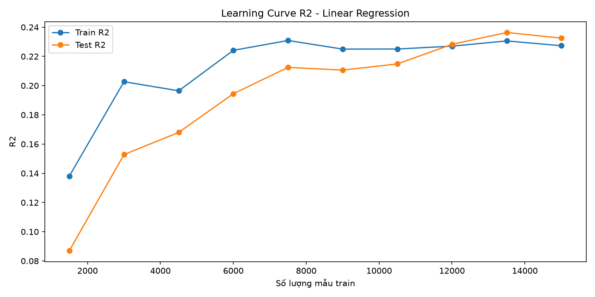
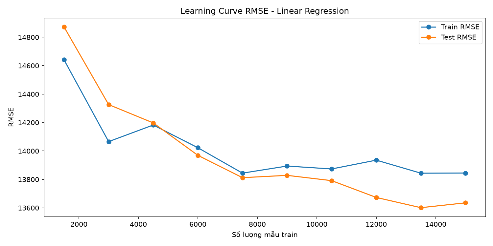

Nhận xét:

- Test R2 có tăng khi thêm dữ liệu, nhưng dừng lại ở mức rất thấp (~0.23).
- Train và test luôn gần nhau và đều thấp — thêm dữ liệu **không giúp ích nhiều** vì vấn đề nằm ở giả định tuyến tính của mô hình, không phải thiếu dữ liệu.

### KNN


Nhận xét:

- Cả Train R2 và Test R2 đều tăng đều khi có thêm dữ liệu.
- KNN hưởng lợi rõ từ việc tăng dữ liệu vì càng nhiều mẫu, các "hàng xóm" càng đại diện tốt hơn cho xe cần dự đoán.

### Decision Tree (giới hạn độ sâu `max_depth`=7)

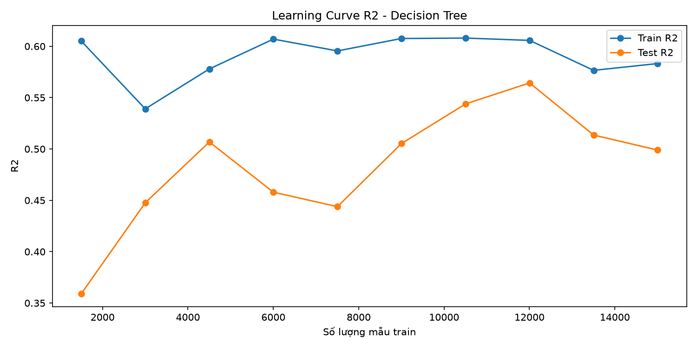
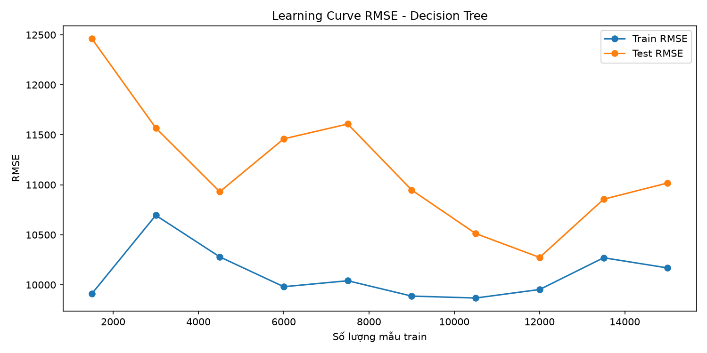

Nhận xét:

- Test RMSE giảm và Test R2 tăng khi thêm dữ liệu, nhưng train vẫn tốt hơn test khá nhiều → vẫn còn overfitting.
- Khi dữ liệu tăng, train và test có xu hướng tiến lại gần nhau hơn, cho thấy thêm dữ liệu giúp giảm overfitting.

### Decision Tree không giới hạn độ sâu

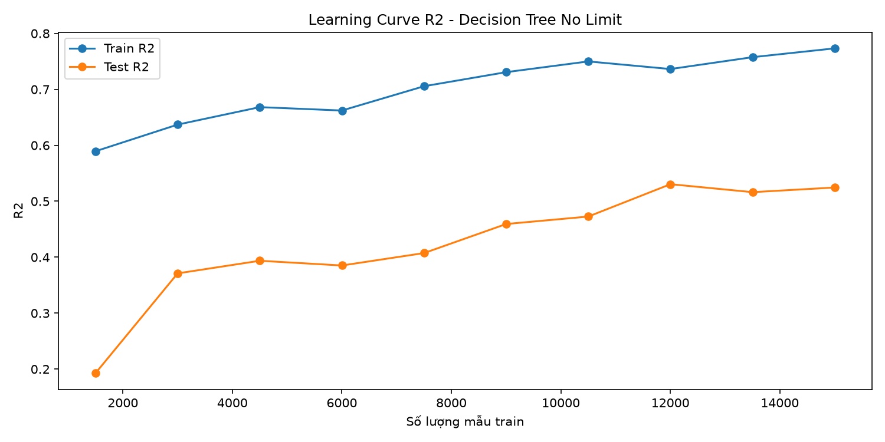
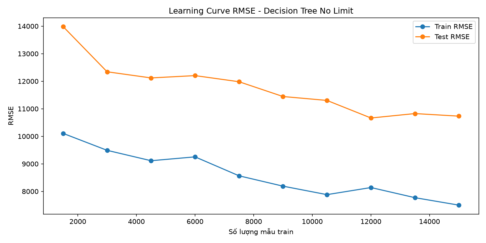

Nhận xét:

- Khoảng cách train/test rất rộng ở dữ liệu nhỏ (0.5894 so với 0.1927) → overfitting nặng khi ít dữ liệu.
- Khi tăng dữ liệu, test cải thiện mạnh và khoảng cách thu hẹp dần, nhưng vẫn còn rõ rệt — đây vẫn là mô hình overfitting nhiều nhất nhóm cây.

### Random Forest

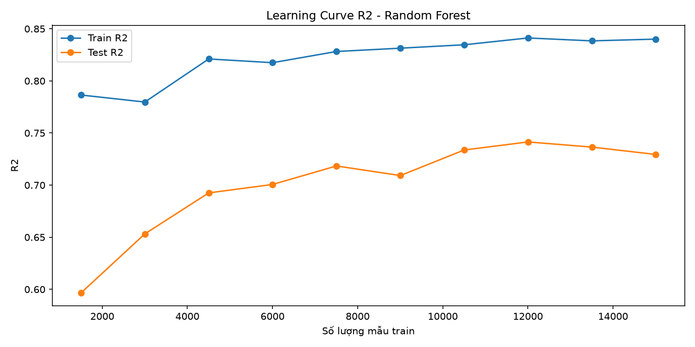
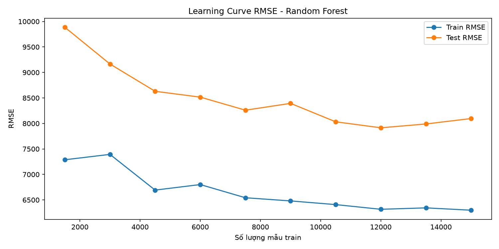

Nhận xét:

- Random Forest có Test RMSE giảm đều và Test R2 tăng đều khi tăng dữ liệu train.
- Khoảng cách train/test ổn định và hẹp hơn các mô hình cây đơn lẻ → khả năng tổng quát hóa tốt nhất.

### 6.6. Đường cong theo độ phức tạp (max_depth)

Khi thay đổi `max_depth` cho cả Decision Tree và Random Forest:

**Decision Tree:**

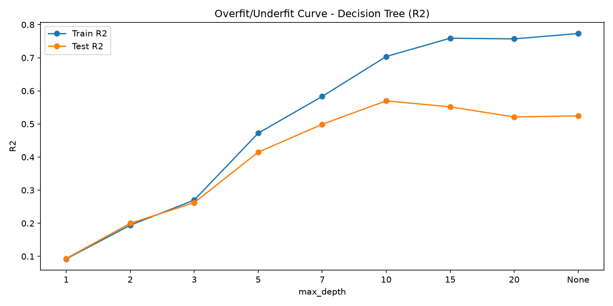
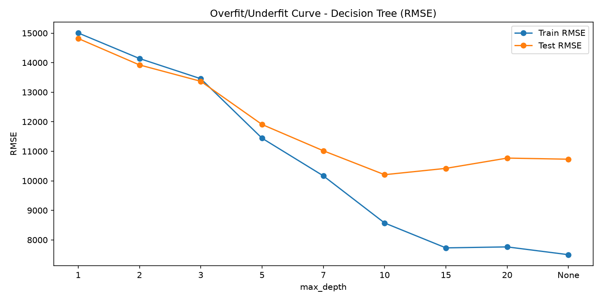


**Random Forest:**

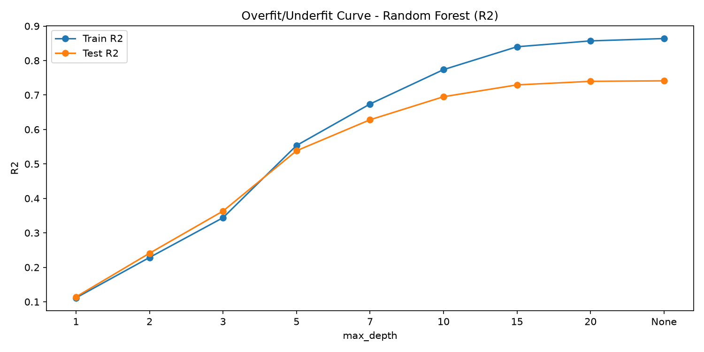
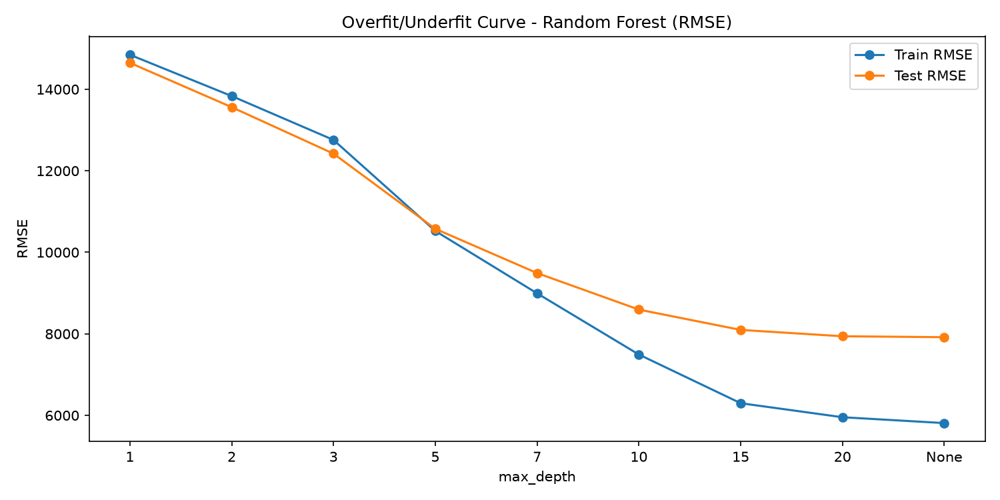

Nhận xét:

- `max_depth=1` đến `3`: mô hình quá đơn giản, train và test đều thấp → vùng **underfitting**.
- Với **Decision Tree**, Test R2 đạt đỉnh tại `max_depth=10` (0.5699), sau đó train tiếp tục tốt lên nhưng test xấu đi → vùng **overfitting**. Điều này cho thấy `max_depth=7` đang dùng vẫn hơi thấp; tăng lên 10 sẽ tốt hơn.
- Với **Random Forest**, test cải thiện đến tận `max_depth=None` (0.7412) mà gần như không bị xấu đi. Nhờ cơ chế gộp nhiều cây, Random Forest **chịu được độ sâu lớn** mà không overfit nghiêm trọng như cây đơn lẻ.

### 6.7. Phân tích đặc trưng quan trọng

#### Theo feature importance của Random Forest

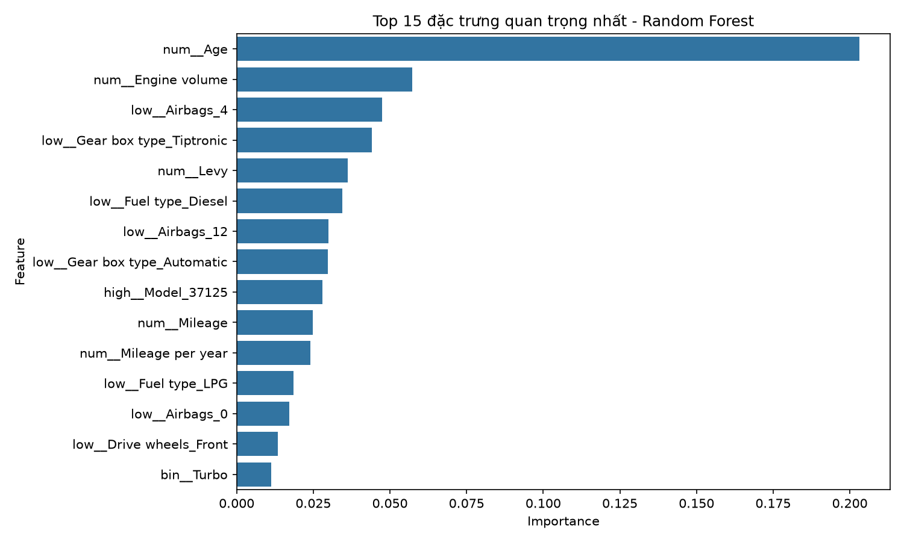

#### Theo SHAP (mức ảnh hưởng trung bình lên dự đoán)

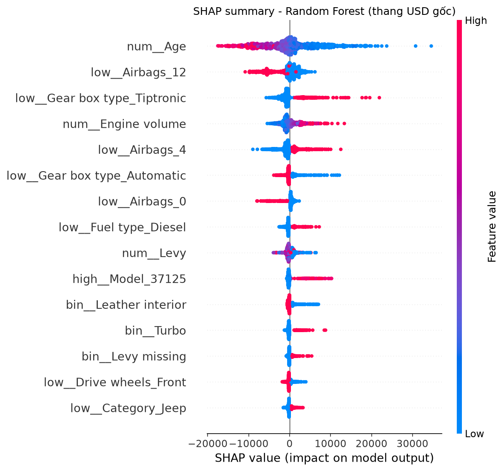

Nhận xét:

- `Age` (tuổi xe) là đặc trưng quan trọng nhất theo **cả hai** phương pháp, bỏ xa các đặc trưng còn lại. Điều này hoàn toàn hợp lý: xe càng cũ thì giá càng giảm.
- `Engine volume` (dung tích động cơ) và loại hộp số (`Gear box type`) cũng có vai trò lớn, phản ánh việc xe mạnh/cao cấp hơn thường đắt hơn.
- Số túi khí (`Airbags`) và loại nhiên liệu (`Fuel type_Diesel`) cho thấy yếu tố an toàn và cấu hình động cơ ảnh hưởng đáng kể đến giá.
- Hai bảng có thứ tự tương đồng (`Age`, `Engine volume`, hộp số, túi khí đều nằm top), củng cố độ tin cậy của kết luận. Khác biệt nhỏ là SHAP đánh giá `Airbags_12` cao hơn, vì SHAP đo trực tiếp mức ảnh hưởng (theo đơn vị giá) lên từng dự đoán, còn feature importance chỉ đo mức giảm sai số trong quá trình tách nhánh.

> Lưu ý: Feature importance và SHAP cho biết mức độ đóng góp của đặc trưng trong mô hình, nhưng không khẳng định quan hệ nhân quả tuyệt đối.

### 6.8. Nhận xét về kết quả dự đoán

#### Nhận xét chung giữa giá thực tế và giá dự đoán

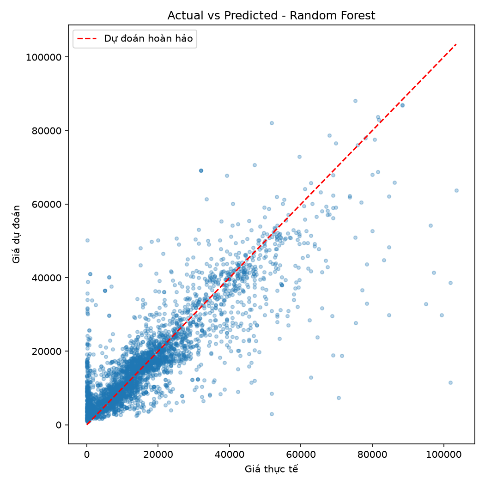
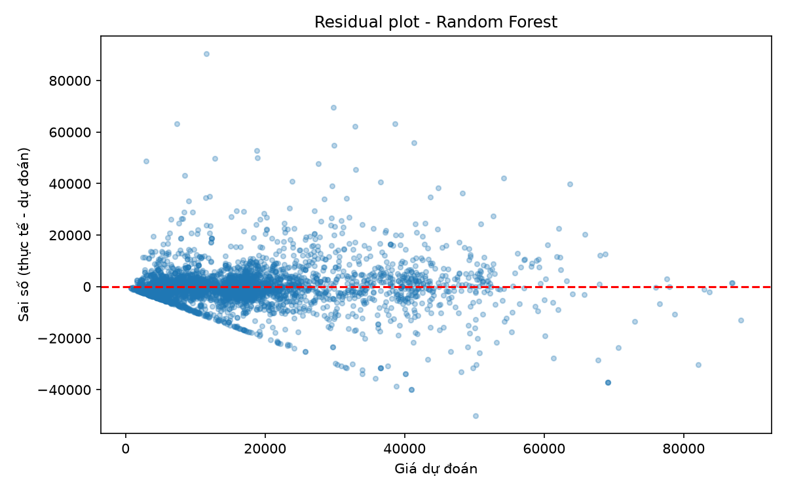

Dựa trên biểu đồ Actual vs Predicted và Residual plot của Random Forest (Test R2 = 0.7294):

- Phần lớn điểm dự đoán bám sát đường chéo "dự đoán hoàn hảo" ở vùng giá thấp đến trung bình. Mô hình dự đoán khá tốt cho nhóm xe phổ thông, phù hợp với việc giải thích được khoảng 73% biến thiên giá xe.
- Ở vùng giá rất thấp (giá thực tế gần 0), mô hình có xu hướng dự đoán **cao hơn thực tế**. Điều này thể hiện rõ qua đường biên chéo ở góc dưới-trái của residual plot: mô hình gần như không dự đoán được các mức giá quá thấp.
- Ở vùng giá cao (trên 60.000), các điểm phân tán rộng hơn hẳn, xuất hiện cả dự đoán thấp hơn lẫn cao hơn thực tế. Mô hình kém tin cậy hơn ở phân khúc xe đắt tiền.
- Trên residual plot, đa số sai số dao động quanh 0, nhưng độ phân tán tăng dần khi giá dự đoán tăng (phương sai sai số không đồng đều). Nghĩa là sai số tuyệt đối có xu hướng lớn hơn ở các xe giá cao.

#### Nhận xét trên 10 mẫu dự đoán cụ thể

| Giá thực tế | Giá dự đoán | Sai số tuyệt đối |
|---:|---:|---:|
| 27,284 | 25,083.59 | 2,200.41 |
| 627 | 13,652.49 | 13,025.49 |
| 4,391 | 3,393.21 | 997.79 |
| 2,038 | 3,836.53 | 1,798.53 |
| 2,100 | 7,014.02 | 4,914.02 |
| 15,681 | 16,768.83 | 1,087.83 |
| 10,036 | 11,591.47 | 1,555.47 |
| 470 | 9,960.99 | 9,490.99 |
| 6,899 | 8,531.81 | 1,632.81 |
| 69,807 | 59,165.04 | 10,641.96 |

Nhận xét:

- Nhiều mẫu được dự đoán rất sát, sai số chỉ khoảng 1.000 đến 2.200 (ví dụ 27,284 → 25,084; 15,681 → 16,769; 4,391 → 3,393; 10,036 → 11,591). Đây đều là các xe ở phân khúc giá phổ thông.
- Hai xe có giá thực tế rất thấp bị dự đoán cao hơn nhiều lần (627 → 13,652 và 470 → 9,961). Đây chính là biểu hiện của hiện tượng dự đoán quá cao ở vùng giá thấp đã nêu.
- Xe đắt nhất trong mẫu (69,807) bị dự đoán thấp hơn thực tế khoảng 10.642, đúng với xu hướng dự đoán thiếu ở phân khúc xe giá cao.

Kết luận: Random Forest dự đoán tốt cho nhóm xe phổ thông, nhưng kém chính xác ở hai cực giá (rất rẻ và rất đắt), nơi sai số tuyệt đối hoặc sai số tương đối đều tăng mạnh.

## 7. Kết luận và hướng cải thiện.
Mô hình **Random Forest** là lựa chọn tốt nhất cho bài toán dự đoán giá xe vì có `Test RMSE` thấp nhất (8,096.37) và `Test R2` cao nhất (0.7294).

Kết quả cho thấy:

- Linear Regression **underfitting** với dữ liệu giá xe, không nắm được quan hệ phi tuyến — không phù hợp làm mô hình chính.
- KNN và Decision Tree cho kết quả trung bình; Decision Tree dễ overfitting nếu không kiểm soát độ sâu (độ sâu tối ưu khoảng `max_depth=10`).
- Decision Tree không giới hạn độ sâu overfitting rõ nhất trong nhóm cây.
- Random Forest cải thiện kết quả bằng cách kết hợp nhiều cây, chịu được độ sâu lớn mà không overfit nghiêm trọng, cho kết quả test tốt nhất.
- Learning curve cho thấy Random Forest và KNN vẫn cải thiện khi tăng dữ liệu train, trong khi Linear Regression ổn định nhưng bị giới hạn bởi giả định tuyến tính.
- `Age` (tuổi xe) là yếu tố quyết định giá mạnh nhất, theo cả feature importance lẫn SHAP.

Về mặt thực tế, mô hình có thể hỗ trợ ước lượng giá xe ban đầu, nhưng chưa nên dùng như công cụ định giá duy nhất (Test R2 chỉ ~0.73). Để triển khai thực tế, cần bổ sung dữ liệu về tình trạng thực tế của xe, lịch sử bảo dưỡng/tai nạn, vùng giá cao và xử lý kỹ các giá bất thường (quá thấp/quá cao) trong dữ liệu.
